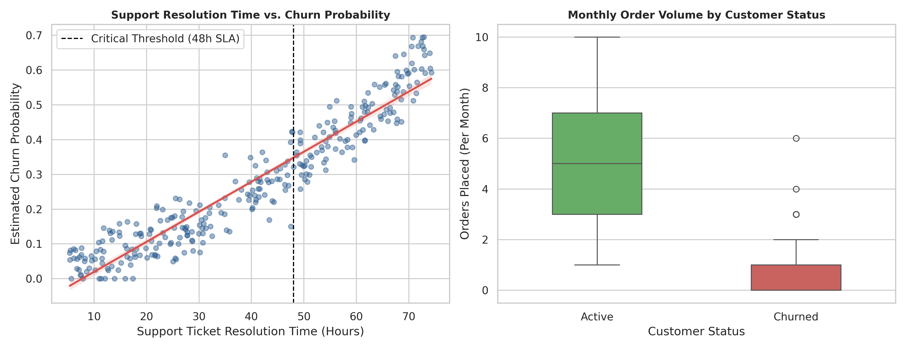

# Data Visualization and Reporting for Business Insights
**Author:** Unnati Mishra  
**Track:** Data Analytics Internship — Week 3 Project  

## Project Overview
This repository contains a comprehensive data visualization framework and executive reporting workflow implemented in Python. It bridges exploratory data analysis (EDA) and executive decision-making through standardized chart selection, rigorous quantitative interpretation thresholds, and diagnostic modeling.

---

## Executive Diagnostic Figure
The visual output generated from the automated analytics pipeline isolates operational SLA breaches and customer behavior metrics:



---

## Repository Contents
- **`data_visualization_analysis.ipynb`**: Complete, runnable Jupyter Notebook executing dataset synthesis, OLS regression modeling, distribution testing, and figure export.
- **`Week3_Data_Visualization_Strategy.docx`**: Formal strategic documentation detailing business impact, visualization taxonomy, and executive governance.
- **`executive_churn_analysis.png`**: High-resolution (300 DPI) dual-panel diagnostic visualization.
- **`requirements.txt`**: Pinned Python library dependencies ensuring reproducibility.

---

## Quantitative Visualization & Decision Framework

| Chart Format | Analytical Objective | Variable Types | Applied Quantitative Benchmarks |
| :--- | :--- | :--- | :--- |
| **Tukey Box Plot** | Distribution shape, skewness, outliers | 1 Continuous, 1 Categorical | Whisker limits set at $Q_1 - 1.5 \times \text{IQR}$ and $Q_3 + 1.5 \times \text{IQR}$. Mild outliers: $[1.5, 3.0] \times \text{IQR}$; extreme: $> 3.0 \times \text{IQR}$. |
| **OLS Scatter Fit** | Bivariate dependency testing | 2 Continuous Numeric | Statistical significance validated at $R^2 \ge 0.60$ and $p < 0.05$. |
| **Correlation Heatmap** | Multicollinearity screening | Matrix of Continuous Data | Flag moderate correlation at $|r| \ge 0.40$, strong at $|r| \ge 0.70$, and collinear redundancy at $|r| \ge 0.85$. |
| **Multi-Line Trend Plot** | Continuous tracking & divergence | 1 Datetime, 1+ Continuous | 7-day rolling average applied to smooth transient noise; flags week-on-week shifts exceeding $\pm 10\%$. |

---

## Statistical Governance Rules
1. **Distribution Skewness:** Where Mean exceeds Median by more than 15%, distributions are marked positively skewed, mandating median/IQR reporting over mean/standard deviation.
2. **Correlation Controls:** High correlation ($|r| \ge 0.70$) warrants mandatory scatter validation to verify findings are not artifacts of high-leverage outliers.
3. **Trend Divergence:** Performance divergence must sustain across three consecutive measurement cycles before triggering operational escalation.

---

## Setup & Local Execution
```bash
# Clone the repository
git clone [https://github.com/mishraunnati07-boop/data-visualization-and-reporting.git](https://github.com/mishraunnati07-boop/data-visualization-and-reporting.git)
cd data-visualization-and-reporting

# Install required dependencies
pip install -r requirements.txt
